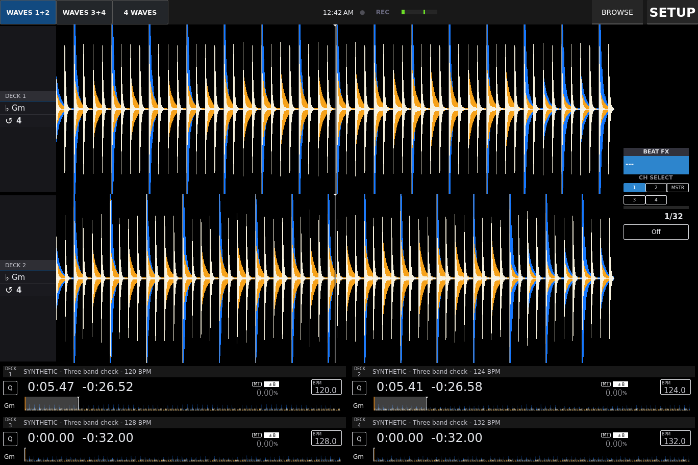

# FLX10 touchscreen interface — AZ Touch

**Recommended free route: Mixxx stable + an AZ-style native skin + the MIDI-only FLX10 mapping.**
This repository now includes a Surface adaptation of Marc Monka’s **XDJ OPEN SOURCE**
skin. Mixxx supplies real audio analysis, three frequency bands, beat grids, cues,
sync and library state. The FLX10 supplies the physical controls.

**Status: Mixxx 0.1.0 hardware-validation candidate.** The skin has run in real
Mixxx 2.5.0 on Linux at 1368 × 912. The Windows target is current stable **2.5.6**;
Windows, Surface touch, FLX10 ASIO/MIDI and your USB library are **not hardware-tested**.
Use the [validation report](docs/mixxx-validation.md) to distinguish actual checks
from remaining work. This is not yet a certified gig setup.



This is an actual Mixxx capture with **generated calibration audio**, not music or a
mock waveform. See the [four-wave](docs/screenshots/mixxx-four-runtime.png) and
[library](docs/screenshots/mixxx-library-runtime.png) captures too.

## Why this route

- Free software and controller use; no subscription or ten-minute hardware limit.
- Native **3-Band** frequency renderer: blue lows, orange mids, ivory highs.
  Vertical beat-grid lines cross the waveform, with a fixed playhead and cue markers.
- Separate **WAVES 1+2**, **WAVES 3+4**, and **4 WAVES** views. Four deck summaries
  remain visible while browsing and changing views. Four-wave order is 3, 1, 2, 4.
- Scrolling and overview waveforms are display-only: mouse/touch input and drops
  are disabled. Use the FLX10 for scratching, seeking and cues.
- Four explicit library load buttons are disabled for playing decks. Mixxx’s
  loading preference also protects hardware/keyboard loads.
- Existing, credited skin and mapping foundations, pinned source downloads,
  a backup-before-install script, and rollback.

The consequential limitation is **OneLibrary**. Mixxx’s current reader looks for
legacy `PIONEER/rekordbox/export.pdb`; OneLibrary support remains an
[open feature request](https://github.com/mixxxdj/mixxx/issues/15556).
A OneLibrary-only USB will not supply its playlists/cues/grids to Mixxx.
The [decision and source audit](docs/best-route.md) explains the alternatives.
If you already own VirtualDJ Pro and want the factory mapping that worked for you,
the [VirtualDJ candidate and full instructions](README-VirtualDJ.md) remain available.

## 1. Install Mixxx and the FLX10 driver

1. Download **Mixxx 2.5.6 stable, Windows 64-bit** from the
   [official download page](https://mixxx.org/download/). Avoid the separate beta
   and nightly sections for the initial setup. Open it once, then close it.
2. Install the official **DDJ-FLX10 Windows audio driver** from
   [AlphaTheta/Pioneer support](https://www.pioneerdj.com/en/support/software/controller/ddj-flx10/).
   Use the vendor’s firmware instructions if an update is needed.
3. Connect the powered FLX10 by USB. Start with a direct connection and leave
   VirtualDJ, rekordbox and Serato closed so they do not hold its ASIO/MIDI ports.
4. On the Surface Pro 7, use landscape **2736 × 1824**, starting at **200% Windows
   scaling**. That corresponds to the tested 1368 × 912 design area. Other scaling
   combinations need checking on the actual Surface.

## 2. Download and install this project

On [GitHub](https://github.com/palermostest25/FLX10-touchscreen-interface), choose
**Code → Download ZIP**, then extract the entire outer ZIP. Python is not needed.

Open ordinary Windows PowerShell in the extracted project folder and run:

```powershell
powershell.exe -NoProfile -ExecutionPolicy Bypass -File .\tools\install_mixxx_windows.ps1 -IncludeController
```

This installs the skin into `%LOCALAPPDATA%\Mixxx\skins\AZ Touch`, downloads
**only two pinned MIDI mapping files** from Veezuhz’s separate MIDI-only folder,
checks their SHA-256 hashes, and installs them under project-specific names.
It selects AZ Touch, the native three-band renderer and overview, 30 FPS,
visible grids, and rejection of loads into playing decks.

It does **not** install a HID screen daemon or replace Mixxx’s
`common-controller-scripts.js`. The MIDI-only script does not need a downloaded
replacement for that built-in file. The Linux screen/USB relay is a different
experiment and is not part of this Windows setup.

The installer prints a timestamped backup directory inside
`%LOCALAPPDATA%\Mixxx\AZTouch-backups`. Save that path. It backs up each existing
file/folder it changes; your library, music, sound routing and other mappings
remain outside the installation targets. A failure during installation triggers
restoration of those targets. `ExecutionPolicy Bypass` applies only to this process.

For a custom Mixxx settings directory, append `-MixxxHome "D:\My Mixxx settings"`.
For a visual-only installation, omit `-IncludeController`; no downloads are needed.

### Manual skin installation

1. Close Mixxx. Back up your settings folder first.
2. Extract **`dist\mixxx\AZ-Touch-Mixxx.zip`** into
   `%LOCALAPPDATA%\Mixxx\skins`. The result must be
   `skins\AZ Touch\skin.xml`, not a second nested skin folder.
3. Open **Preferences → Interface → Skin → AZ Touch**.
4. In **Preferences → Waveforms**, choose a **3-Band** scrolling renderer and
   **3-Band** overview. Use 30 FPS and about 80% beat-grid opacity initially.
   The three-band choice is essential: choosing RGB produces blended colours.
5. In **Preferences → Decks**, set loading into a playing deck to **Reject**.
6. For the manual controller route, use the exact commit and folder in
   [controller-sources.lock.json](mixxx/controller-sources.lock.json), copy its
   XML and JavaScript together into `Mixxx\controllers`, and retain the script
   filename referenced by the XML. The scripted installation handles this for you.

## 3. Enable the mapping and configure audio

1. Open **Preferences → Controllers**, select the FLX10 MIDI device and the preset
   **AZ Touch FLX10 - MIDI only**, then enable it. Disable other FLX10 presets to
   avoid duplicate handling. A manual unrenamed install may appear as **DDJ-FLX10 PROD**.
2. In **Preferences → Sound Hardware**, select **ASIO** and **DDJ-FLX10 ASIO**.
3. Start with internal/software mixing: **Main → FLX10 channels 1–2** and
   **Headphones → channels 3–4**. These channel pairs match the manufacturer-device
   configuration shown in the [VirtualDJ FLX10 setup guide](https://virtualdj.com/manuals/hardware/pioneer/ddjflx10/setup.html);
   their operation in Mixxx still needs a physical check. Do not also assign
   separate deck outputs while testing this internal-mixer mapping.
4. Match the driver’s sample rate. Start with a conservative buffer, such as
   512 frames, then reduce it only after clean playback. The installer deliberately
   leaves audio configuration to Mixxx and the device driver.
5. Set the channel input selectors to the connected USB port. With speakers low,
   test one deck, its channel fader/EQ, master output, then headphone CUE and
   cue/master mix. Repeat on all four decks before assuming routing is correct.
6. Use **Options → Full Screen**. Alt exposes the menu bar when hidden;
   **Preferences** remains available there. **SETUP** opens the skin’s view and
   recording page; detailed audio/waveform preferences are Mixxx’s native dialog.

The mapping supplies core MIDI controls, not a complete rekordbox feature clone.
Jog-screen waveforms, DMX, Mix Point Link and stems are not promised. Beat FX use
Mixxx effect chains; FLX10 printed effect names do not automatically recreate
Pioneer’s algorithms. Configure chains following the
[upstream mapping instructions](https://github.com/Veezuhz/Mixxx_FLX10_Controller_Mapping/tree/c668a0b0aa3d1230e19806380f1a711ea7a0f271/NON-HID%20FLX10%20Controller%20(working)(most%20stable)).

## 4. Check a cloned rekordbox USB

Keep the original drive unchanged. On a cloned test USB, replace `E:\` below with
its actual root. This command only checks whether the database files exist:

```powershell
powershell.exe -NoProfile -ExecutionPolicy Bypass -File .\tools\check_rekordbox_usb.ps1 -DriveRoot 'E:\'
```

- **LegacyDeviceLibrary = True:** in Mixxx’s library sidebar, enable/select
  **Rekordbox**, refresh attached devices, and open the clone’s playlists. Mixxx’s
  [manual](https://manual.mixxx.org/2.5/en/chapters/library.html#using-the-rekordbox-library)
  describes FAT/HFS export media. Start Windows tests with a FAT32 clone.
- **OneLibrary = True, LegacyDeviceLibrary = False:** stop this import route.
  Browsing the audio files as folders is possible, but it does not preserve the
  OneLibrary playlists, hotcues or grids. If you choose to make a legacy export,
  do it to a separate test drive in rekordbox; this project performs no conversion.
- **Both = True:** Mixxx uses the legacy database. This does not mean it reads
  OneLibrary. Verify the legacy playlists and metadata are current.

Check several tracks’ hotcues, grid alignment, loops and paths against rekordbox.
Avoid adding the original USB as a watched music directory. Keep tag writing
turned off during clone tests. The checker does not certify database contents,
filesystem compatibility or a successful import.

## 5. Prove the setup before using it

Use the [test checklist](docs/mixxx-validation.md). Start with two local tracks
and different analysed BPMs. Test transport, jog touch/nudge, pitch direction,
channel routing, loops, pad colours and CUE on each deck. Press SYNC and check both
BPM and audible beat alignment over time; a matching number alone is insufficient.

Test drags/taps across rolling and overview waves, including while playing.
Their position must not jump. Open Browse, select a different track and verify a
playing deck’s load button is disabled; hardware LOAD must also refuse replacement.
Use the FLX10 for playback controls, then check the 1+2, 3+4 and four-wave pages.

If the waveforms are absent, choose another supported **3-Band** renderer in
Preferences. If MIDI works but audio does not, check ASIO routing and close other
DJ applications; do not install the Linux USB relay to fix Windows audio.

## Roll back

Close Mixxx and run with the exact backup path printed during installation:

```powershell
powershell.exe -NoProfile -ExecutionPolicy Bypass -File .\tools\restore_mixxx_windows.ps1 -BackupPath 'C:\Users\YOU\AppData\Local\Mixxx\AZTouch-backups\YOUR-BACKUP'
```

The script restores the previous configuration and installation targets, removing
new targets that did not exist before installation. It retains the backup itself.
For manual installs, select your former skin and mapping, then remove only the
AZ Touch skin folder and its two mapping files.

## Sources, licences and development

The skin is derived from **Marc Monka’s XDJ OPEN SOURCE**, commit
`9139ff1418b283c98befc90f41760dff620b2cbf`, under its included **GPL v3** licence.
See [source and modifications](mixxx/UPSTREAM.md). The GPL skin and its source
are separate from the repository’s MIT-licensed original utilities and VirtualDJ
candidate. No controller-mapping files or DJ software binaries are redistributed.

Build and check the source:

```sh
python tools/build_mixxx_skin.py
python tools/build_skin.py
python -m unittest discover -s tests -p 'test_*.py'
```

PowerShell file-operation fixtures are `tests/test_mixxx_windows.ps1` and
`tests/test_windows_scripts.ps1`. See the validation report for their execution
platform and the distinction from hardware tests.
