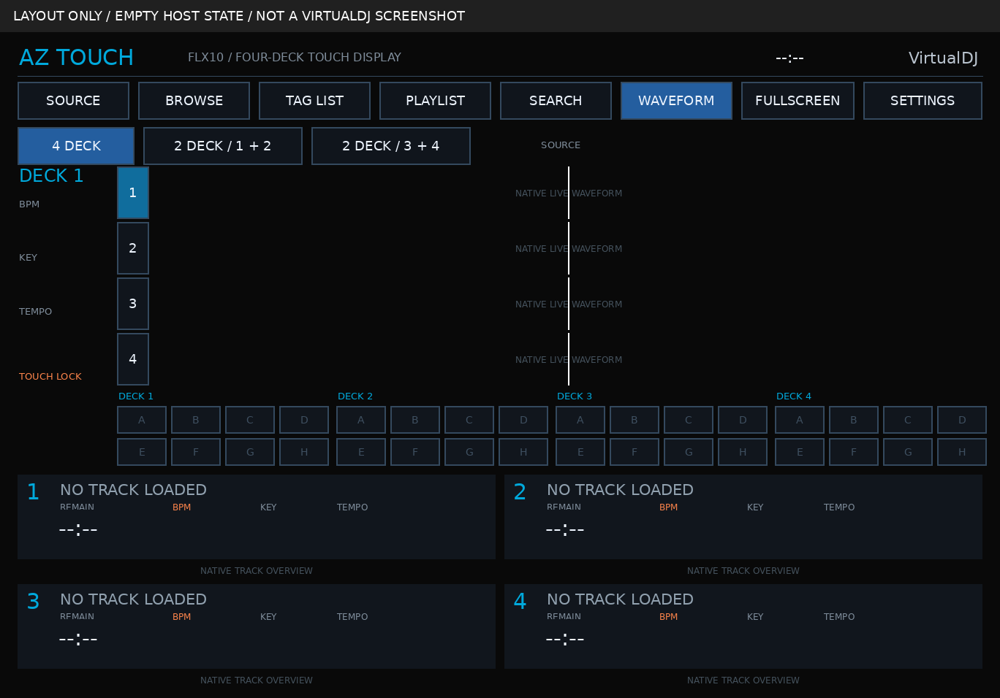

# Touchy AZ reference alignment — 0.2.0

The visual target is the screenshot of **Touchy AZ by Kiwi Gazza**, linked in
the supplied brief, rather than the brief's newly drawn illustrative wireframes.
The first implementation missed this distinction and used a generic row/card UI.

Inspected source:
[author's VirtualDJ thread](https://virtualdj.com/forums/269853/VirtualDJ_Skins/%5BWIP%5D_Touchy_-_touch-first_skin_family_%28CDJ_%2F_XDJ-style%29_for_touchscreens.html)
and [AZ screenshot](https://virtualdj.com/img/471436/49101/listing-main-az.png).
Checked 14 October 2026. The author describes stacked waves at the top, cues
in the middle and deck strips below. The thread records catalog rejection and
requests for a release; no downloadable skin ZIP is present in that thread.
The original screenshot is linked for attribution, not bundled as skin artwork.

| Visible reference feature | Revised implementation |
|---|---|
| Nearly black background, square outlined controls | Black canvas, flat square controls with restrained blue selection |
| Long stacked waveforms and numbered left column | Four native full-color scratchwaves at the top; two larger pair modes |
| Selected deck information at the left | Display-only sidebar with BPM, key and tempo for selected number |
| Cue bank across the middle | Four groups of eight host-bound passive cue labels |
| Large lower deck blocks, paired 1/2 and 3/4 | 2×2 player grid with title, time, orange BPM, key, tempo and overview waveform |
| Full track overview in each lower player | Native songpos per deck, with native marker sprites and input shields |

Differences remain explicit: the Surface canvas is 3:2; the linked screenshot
is cropped and watermarked; original source/graphics are unavailable; active
key/beatjump/pads/FX are not blindly reproduced without target verification.
Cues remain passive in this candidate, needle locking has not been proven on
hardware, and all native functions still need testing in VirtualDJ. No exact
copy of the author's skin is claimed.

The diagram is generated by `tools/render_layout.py`. Its waveform regions
are labeled placeholders, with no invented song names/audio bars. The actual
skin uses only native VirtualDJ waveform renderers; the diagram isn't packaged
as a skin background or preview.
