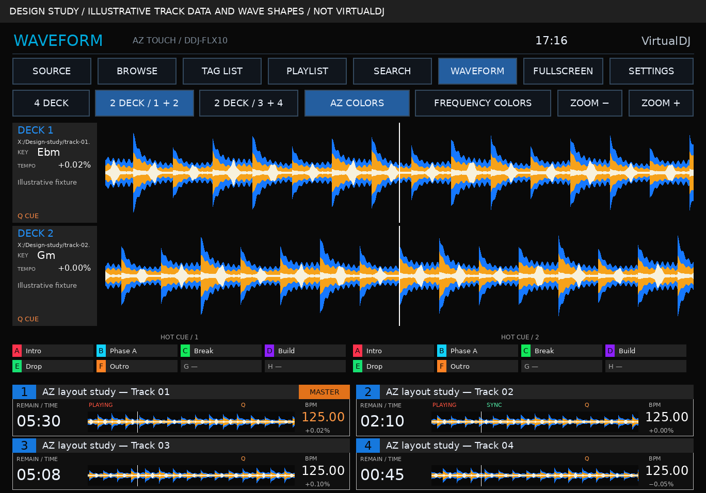
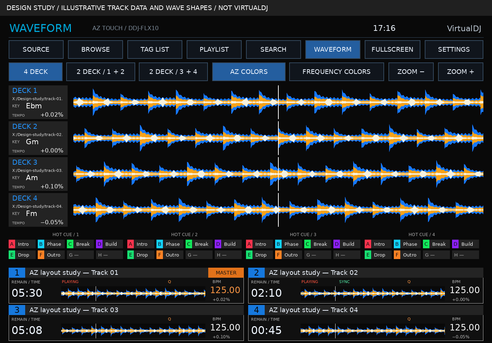

# Actual XDJ-AZ reference alignment — 0.3.0

The current visual authority is the real XDJ-AZ waveform screen linked in the
handoff. User clarified the priority is appearance and no sync test has been
tried. Touchy remains a related reference, rather than replacing inspection of
actual hardware UI.

[Actual AZ waveform screen](https://cdn.shopify.com/s/files/1/0503/4049/5523/files/XDJ-AZ_GUI_Main-screen_WAVEFORM_1280x800_d3446b73-de29-4085-ba0e-b28cb240118a_2048x2048.jpg?v=1728596761)
shows large blue/orange/ivory waves, per-wave source/key panels, cue-name banks
and compact time/overview/BPM strips. The photograph is linked for attribution;
it is not bundled or sliced into the skin.

| Reference detail | 0.3.0 implementation |
|---|---|
| Dark flat equipment UI | Black background, charcoal cells, square controls, white labels |
| Metadata beside scrolling waves | Deck number, real file path, musical key and tempo |
| Blue/orange/ivory treatment | Documented shape palette plus separate frequency-color option |
| Two large waves, four players | Startup 1+2 pair; alternate 3+4 and four-wave modes |
| Middle cue-name banks | Active-wave banks, slot-letter colors and native cue-name text |
| Compact lower strips | Title, time at left, native overview in center, BPM at right; 1/2 above 3/4 |
| Master / sync state | Passive native masterdeck/is_sync queries, no mapper changes |

Surface canvas is 1368×912 (3:2); hardware reference is 1280×800. Geometry is
adapted, not stretched. Host navigation/settings remain available. No
functional-looking FX panel is added without trustworthy effect feedback.

Exact AlphaTheta frequency analysis is not claimed. AZ COLORS uses
blue/orange/ivory stem shapes. FREQUENCY COLORS uses the host's actual
frequency renderer and palette. See [waveform notes](waveform-modes.md).

These visual studies are labeled at the top. Their example track values and
wave shapes do not ship in the skin XML/PNG ZIP and cannot prove runtime
rendering, import or sync. The empty-state diagram is also available.

[Touchy author thread](https://virtualdj.com/forums/269853/VirtualDJ_Skins/%5BWIP%5D_Touchy_-_touch-first_skin_family_%28CDJ_%2F_XDJ-style%29_for_touchscreens.html)
was checked earlier and provided no public skin ZIP. No original skin source
or third-party graphic assets have been copied into this implementation.
